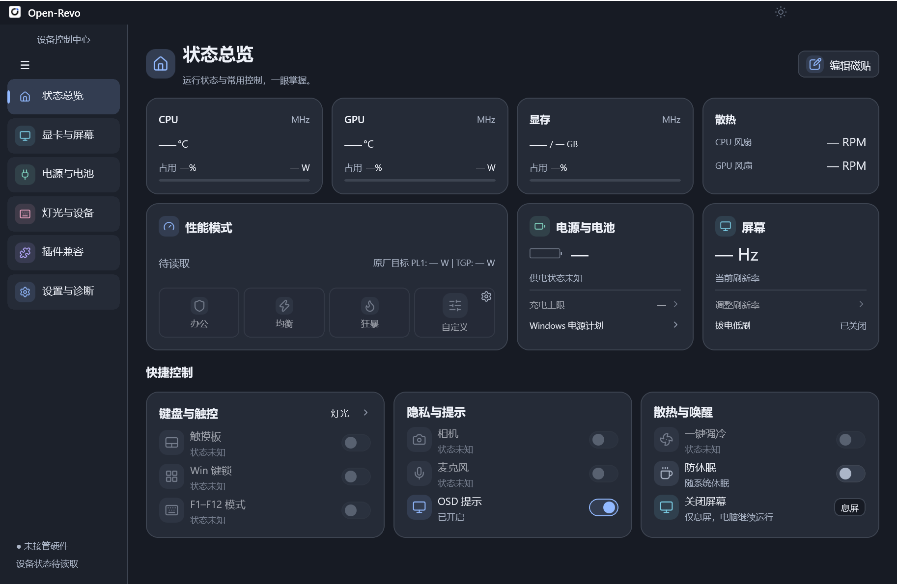
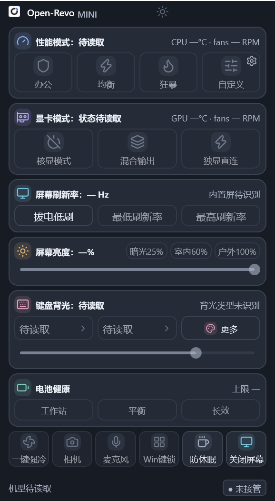

<p align="center">
  
</p>

<h1 align="center">OpenRevo · WinUI 3</h1>

<p align="center">面向兼容的机械革命和同方笔记本的开源 Windows 控制中心</p>

<p align="center">
  <a href="https://github.com/csucm/open-revo-winUI3/releases/latest"><strong>下载 Windows x64 安装包</strong></a> ·
  <a href="#插件开发与贡献">插件开发</a> ·
  <a href="https://github.com/csucm/open-revo-winUI3/issues">反馈问题</a> ·
  <a href="README_en.md">English</a>
</p>

OpenRevo WinUI 3 版基于上游 OpenRevo，由社区维护。在一个面板中查看硬件状态、切换性能档位、设置充电上限，以及调整屏幕和键盘背光。完整面板适合查看数据和调整设置，托盘里的 Mini 小面板适合随手切换常用选项。

> [!IMPORTANT]
> **本项目免费提供安装包和对应源码。** OpenRevo WinUI 3 版由社区独立维护，与机械革命、同方及其他硬件厂商无隶属或背书关系。 [项目发布页](https://github.com/csucm/open-revo-winUI3/releases) · [开源许可证](LICENSE)

## 界面预览

<table>
  <tr><th>状态总览</th><th>Mini 小面板</th></tr>
  <tr>
    <td></td>
    <td></td>
  </tr>
</table>

截图来自早期 WinUI 版本。可见控件和实时读数随设备与软件版本而异。 [更多界面截图](docs/previews/native-0.9.8/README.md)

## 主要功能

### 全新 WinUI 3 界面与布局自定义

- **完整面板与 Mini 小面板。** 完整面板把硬件读数和日常控制集中在总览，并将显卡与屏幕、电源与电池、灯光与设备及设置放在各自的页面。Mini 则从托盘打开，适合边工作边切换档位、亮度或其他常用设置。
- **自己排列总览。** 在「状态总览 → 编辑磁贴」中增删和拖动磁贴，把常看的 CPU、GPU、显存和风扇读数放在前面。编辑完成后可以保存，也可以取消本次更改。 [磁贴编辑预览](docs/previews/native-0.9.8/overview-editing.png)
- **单独定制 Mini。** 在「设置与诊断 → 小面板自定义」中挑选并排序上方磁贴，再为底部六个位置挑选快捷按钮。可以从控件库拖入、交换位置、留空，也可以恢复默认布局。保存后，小面板按你选的方式显示。
- **自定义主题、动效和提示。** 主题可选浅色、深色或跟随 Windows。界面动效可调速或关闭，并遵循 Windows 的减少动画设置。OSD 屏幕提示可单独调整风格、大小和位置，并在设置页预览。托盘可固定打开 Mini 或完整面板，也可以记忆上次形态。Mini 可设置为点击外部后自动收起。 [OSD 设置预览](docs/previews/native-0.9.8/osd-settings.png)

### 硬件控制与监测

| 功能 | 可以做什么 |
| --- | --- |
| 实时监测 | 在总览查看处理器和显卡的温度、频率、占用与功耗，以及显存和风扇转速。具体读数随设备能力而异。 |
| 性能与散热 | 在办公、均衡、狂暴档之间切换。在支持的设备上，可开启一键强冷、调整 CPU/GPU 功耗与风扇曲线，并保存自定义调校预设。 |
| 电源与电池 | 查看电量和供电状态，在支持的设备上选择 60%、80% 或 100% 充电上限预设，并设置睡眠和供电策略。 |
| 显卡与屏幕 | 在支持的设备上切换核显、混合输出或独显直连，调整内屏亮度和刷新率，并可启用拔电后降低刷新率。 |
| 灯光与快捷控制 | 根据键盘类型调整背光亮度、颜色和效果。根据设备能力使用触控板、Fn 锁、Win 键锁等快捷开关。 |

WinUI 3 面板与 Rust 后台分开运行。关闭面板后，界面进程退出，后台继续处理托盘和已启用的策略。要结束后台，可在托盘菜单中选择「退出」。

硬件功能取决于机型、固件、驱动和当前设备状态。同一系列的不同配置也可能提供不同的显卡、灯光或散热选项。

## 插件开发与贡献

**欢迎开发者一起开发 OpenRevo 的原生插件系统。** 你可以编写插件和配色方案，也可以参与改进 SDK、示例、文档和测试。现有 C#/.NET 10 SDK 提供由 WinUI 宿主绘制的原生插件页面、系统状态与电源事件订阅、插件独立配置，以及静态配色。带逻辑的插件在隔离进程中运行，性能档位、强冷和充电上限等动作由宿主按用户授权和设备能力执行。

1. 从 [插件开发指南](native/plugin-dev/README.md) 和 [最小插件模板](native/plugin-dev/template/) 开始。也可以直接查看 [系统摘要示例](native/plugin-dev/SystemSummary/) 或 [静态主题示例](native/plugin-dev/NaiwaTheme/) 选一个方向上手。
2. 在仓库根目录用 PowerShell 构建 SDK 和示例。

   ```powershell
   & .\native\plugin-dev\Build-Framework.ps1 -OutputDirectory .\work\native-plugin-framework
   ```

   从构建输出的 `examples` 中选一个插件，把含 `plugin.json` 的整个子目录放到 OpenRevo 安装目录的 `plugins` 下，再到「插件兼容」页面点「刷新载入」。编写涉及硬件的插件前，请查看 [可用能力和权限](native/PLUGIN-API-INVENTORY.md)。

3. 想新增接口或改进插件框架，可以先在 [Issues](https://github.com/csucm/open-revo-winUI3/issues) 说明用例、所需状态和权限，也欢迎直接提交 Pull Request。原生控件、布局、主题覆盖、生命周期和开发工具都欢迎贡献。

插件 API 仍在开发，实际可用能力以宿主的能力查询为准。 [插件 SDK 源码](native/src/OpenRevo.PluginSdk/) · [原生插件框架说明](native/NATIVE-PLUGIN-FRAMEWORK.md)

## 安装与使用

1. 打开 [GitHub 最新发布页](https://github.com/csucm/open-revo-winUI3/releases/latest)，在附件中下载名称以 `Setup-x64.exe` 结尾的安装包。对应源码和各版本更新说明也在发布页。
2. 覆盖升级前，从托盘菜单完全退出旧版。运行安装器，按提示检查 .NET 10 x64 Desktop Runtime 和 Windows App Runtime。
3. 安装后从开始菜单打开 OpenRevo。需要使用设备控制时，在「设置与诊断」中检查硬件接管状态。关闭面板后，可从托盘重新打开。

## 开源与分发

本项目采用 **GPL-3.0-or-later**。你可以按许可证使用、研究、修改和再分发软件。再分发时须遵守相应的许可证、版权声明和对应源码义务。第三方收费分发并不代表项目授权或背书。如果下载页以本项目名义收费，请通过本仓库核对来源。 [许可证全文](LICENSE)

## 使用注意与免责声明

- **硬件调校。** 修改功耗、风扇曲线或显卡模式前，请先保存工作、记下原设置，确认设备和供电条件支持该操作。同一项硬件设置请只交由一个控制工具管理。若出现异常，请停止调校，从托盘完全退出 OpenRevo，并检查设备状态。
- **兼容与担保。** 社区无法验证所有机型、固件和驱动组合。在适用法律允许的范围内，软件按现状提供，不作明示或默示担保。担保与责任限制详见许可证第 15 至 17 节。 [许可证全文](LICENSE)

## 源码与反馈

遇到设备兼容问题时，请在反馈中注明具体机型、BIOS 版本和复现步骤。诊断报告可从「设置与诊断」导出。上传前请查看报告内容，移除不愿公开的信息。 [提交问题](https://github.com/csucm/open-revo-winUI3/issues) · [诊断说明](native/DIAGNOSTICS.md)

开发者可从 `native/` 开始。 [构建说明](BUILDING.md) · [文档导航](docs/README.md) · [历史版本记录](CHANGELOG.md)

WinUI 3 版源自 [faintonce/open-revo](https://github.com/faintonce/open-revo)。
