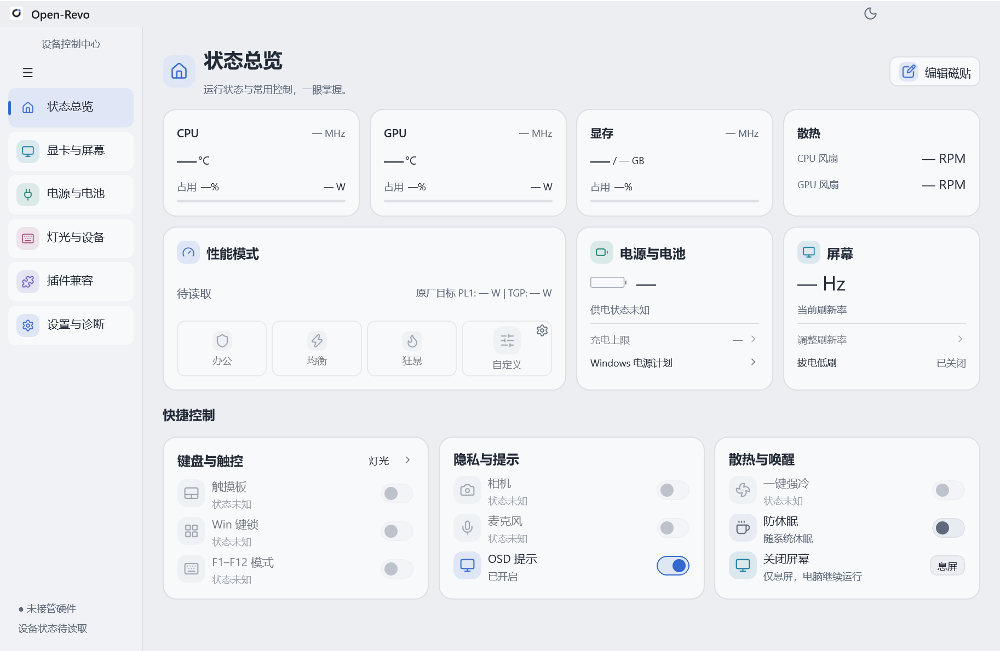
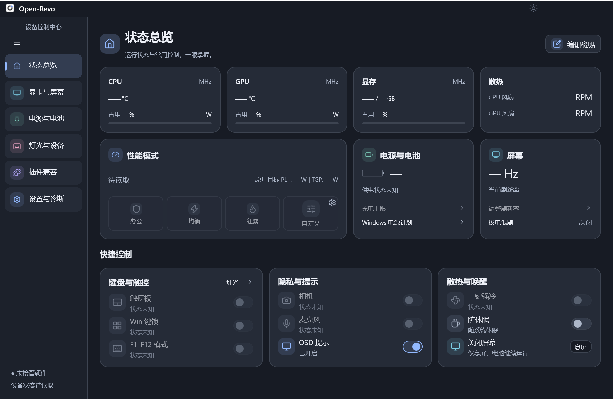
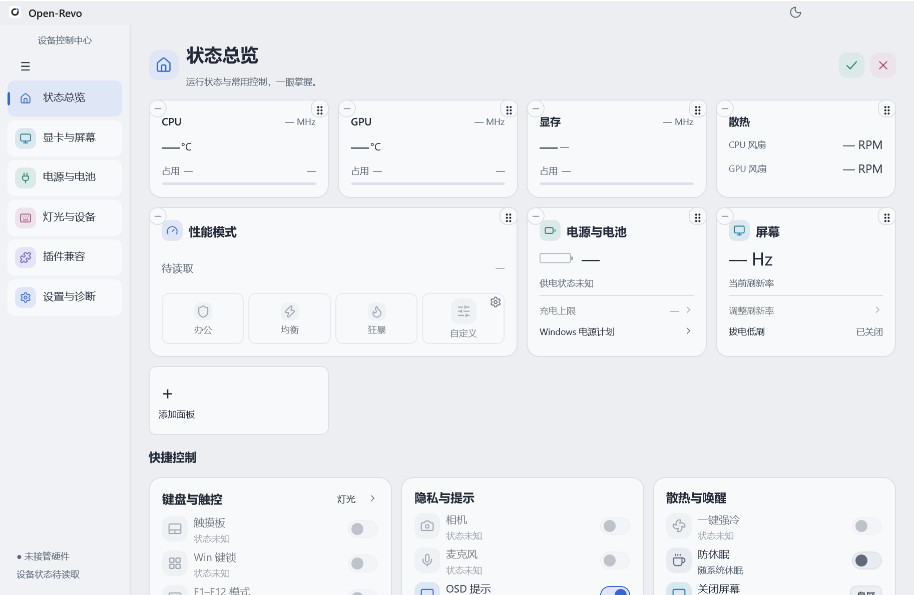
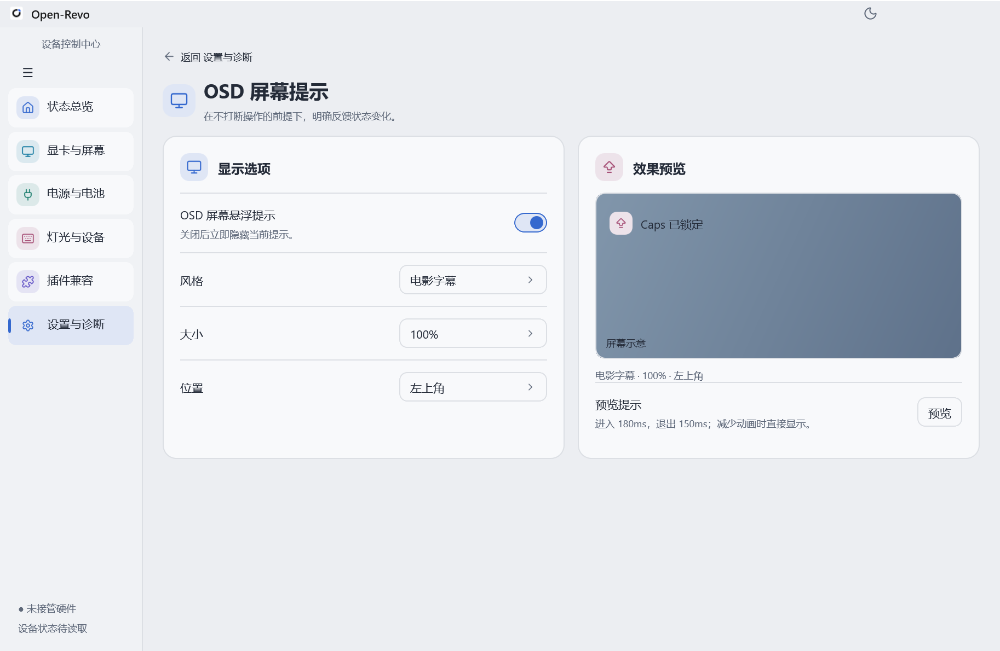
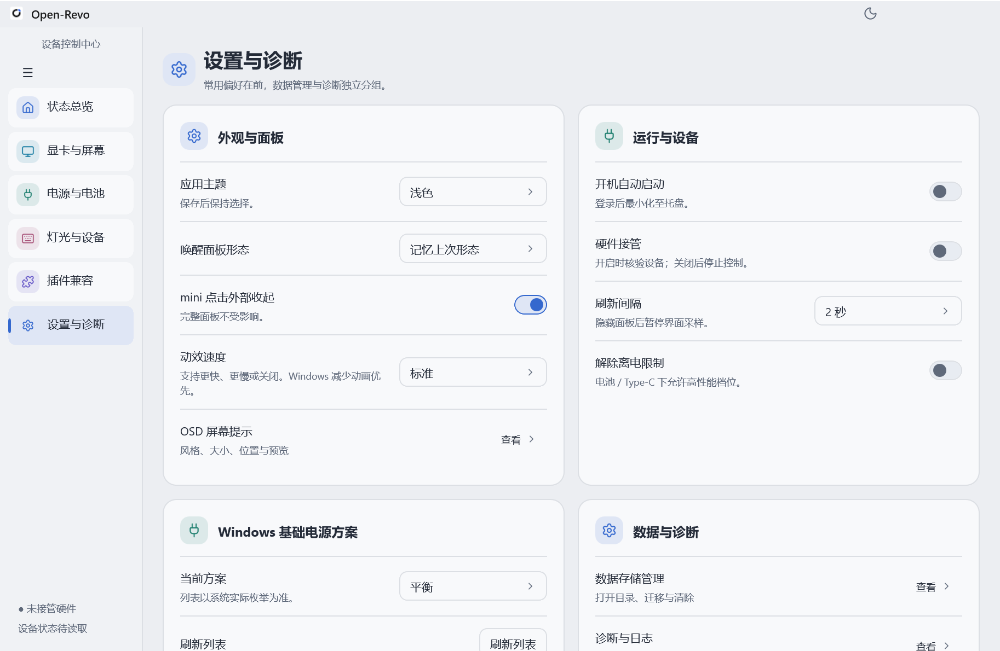

# OpenRevo Native 0.6.9

Windows x64 · WinUI 3 社区预发布版

当前版本 **0.6.9** 已更新机型适配、GPU 读取、模式与电池控制，加入 mini 自定义、双向拖动交换、切屏亮度重读及诊断 Bug 提交。

[下载 0.6.9 安装包](https://github.com/csucm/open-revo-winUI3/releases/download/native-v0.6.9/Open-Revo-0.6.9-Setup-x64.exe) · [完整对应源码](https://github.com/csucm/open-revo-winUI3/releases/download/native-v0.6.9/native-source-0.6.9.zip) · [相比 0.6.8 的更新日志](docs/releases/0.6.9.md) · [发布页](https://github.com/csucm/open-revo-winUI3/releases/tag/native-v0.6.9)

- 修复部分机型模式切换误拒绝、已验证机型电池档位误禁用及 NVIDIA 独显型号缺失。
- mini 支持布局与六槽快捷按钮自定义；编辑拖动跨区保持顶层可见，支持双向交换和取消。
- 每次切屏后重新读取亮度，拖动百分比即时跟随；总览增加 CPU/GPU 型号并保留最小窗口四列布局。
- 新增网页 Issue 提交、关于赞助与交流群入口，统一公开版本显示。

**升级提示：** 历史 0.6.8 仅改发布标识，原安装包内部仍显示 0.9.8，可能无法自动识别 0.6.9。请从本页手动下载安装。当前软件与安装器使用公开版本 0.6.9，内部测试代号独立管理。

共享 .NET 10 x64 Desktop Runtime 与 Windows App Runtime；安装器保留运行时检测及引导。GPL-3.0-or-later 社区移植版，保留上游版权。插件仍在开发中。

## 构建、维护与旧工程

当前源码入口为 `native/`，参见 [构建说明](BUILDING.md)、[维护与归档映射](MAINTENANCE.md)、[协作规则](AGENTS.md) 和 [文档导航](docs/README.md)。

原 Tauri/Web 工程及网页插件样例已完整保存在 [archive-tauri-web-20261107](https://github.com/csucm/open-revo-winUI3/tree/archive-tauri-web-20261107)。主分支保留当前 C# 界面、适配 Rust Core/桥接及安装器；不再使用根 Node/pnpm 入口或旧 Tauri/Gitee 自动流程。当前 Native 源文件和已发布 0.6.9 附件没有因这次整理改变。

## 0.6.8 界面介绍与历史截图

下方保留 0.6.8 的界面说明和当时的截图，当前变化以 [0.6.9 更新日志](docs/releases/0.6.9.md) 为准。

Windows x64 · WinUI 3 社区预发布版 · 2026-11-03

**0.6.8 是一次覆盖大面板、mini、详情页、导航、灯光、设置和 OSD 的界面重写。** 按已确认的设计重新实现控件、图标与布局，让常用信息和操作在同一套视觉语言下保持一致。继续采用原生 Windows 窗口，不启动 WebView2 网页宿主。

[下载安装包](https://github.com/csucm/open-revo-winUI3/releases/download/native-v0.6.8/Open-Revo-0.6.8-Setup-x64.exe) · [下载 GPL 对应源码](https://github.com/csucm/open-revo-winUI3/releases/download/native-v0.6.8/native-source-0.6.8.zip)

## 本次更新一览

| 模块 | 0.6.8 的变化 |
| --- | --- |
| 界面 | 重写主要页面的卡片、按钮、开关、滑条、选择器和图标，统一浅色/深色主题 |
| 状态总览 | 上方磁贴支持编辑、拖动排序、移除、重新添加、保存和取消 |
| mini | 保持紧凑分区，无滚动条，修正模式文字裁剪和快捷按钮文字偏移 |
| 导航 | 支持手动展开/收起、随窗口宽度自动折叠，改善折叠图标与返回入口对齐 |
| OSD | 重做三种样式的半透明与进出显示，完善后台 Caps 和常用快捷操作反馈 |
| 动效 | 增加快/标准/慢/关闭选项，各档时长按本轮反馈减半，优化大小面板连续切换 |
| 设置 | 常用外观选项前置，“关于”中恢复检查更新与更新详情入口 |
| 部署 | 改用共享 .NET 10 桌面运行时，安装包约 11.00 MiB，继续提供完整对应源码 |

> 下方图片来自 0.6.8 源码的隔离只读原生界面渲染。没有连接硬件，未读取的指标显示“—”或“待读取”。这些是程序界面截图，不是网页设计稿或实机性能数据。系统绘制的窗口边框和标题栏按钮不包含在 XAML 客户区截图中。

## 1. 全新的大面板与统一图标

- 重新组织状态总览、显卡与屏幕、电源与电池、灯光与设备、插件兼容、设置与诊断及其二级页面。
- 自绘主要交互控件，减少默认控件外观对已确认设计的影响；字号、卡片圆角、边框、间距和图标保持统一。
- 浅色与深色主题采用相应的文字、表面和图标配色，保留黑蓝圆角应用图标。
- CPU、GPU、显存、风扇、性能模式、电源与屏幕信息集中展示。未知状态保留控件和占位，不用虚构数据填充。
- 快捷控制分成独立的“键盘与触控”“隐私与提示”“散热与唤醒”三张卡片。





## 2. 可以编辑和拖动的总览磁贴

- 点击“编辑磁贴”进入编辑模式，入口切换为两个紧凑的保存/取消图标。
- 拖动上方磁贴调整顺序；减号用于移除，“添加面板”用于恢复可用项目。
- 保存才提交布局；取消恢复之前的布局。拖动中按 Esc、失焦或丢失指针捕获时撤回本次拖动。
- 下方快捷控制保持独立，不参与上方磁贴排序。
- 重新设计编辑、对勾和取消图标，避免原先大按钮、冗余文字与对勾辨识度不足的问题。



## 3. 紧凑、无滚动的 mini

- 保留性能模式、显卡模式、刷新率、屏幕亮度、键盘背光、电池健康和底部快捷控制的固定分区。
- 根据内容确定面板高度，减少底部空白，不依赖滚动查看常用操作。
- 修正“均衡”“自定义”等模式文字裁剪，统一快捷按钮文字居中与图标对齐。
- 屏幕亮度与键盘背光使用一致的轨道宽度；未知设备保留完整位置并禁用相关操作。
- 保留 mini 点击外部收起、托盘唤醒、大小面板切换及既有退出语义。


## 4. 导航、窗口缩放和整体切换

- “设备控制中心”置于侧栏顶部居中，展开时菜单按钮靠左；折叠时菜单按钮与各导航图标居中。
- 根据合适的窗口宽度自动折叠或展开，保留用户手动选择。跨过响应宽度区间后恢复自动布局。
- 二级页面返回入口与正文左边界对齐，减少不同页面之间的位置跳变。
- 窗口缩放时复用导航元素和已加载的 SVG 源，减少反复创建图标造成的闪烁与重排。
- 大小面板在同一个窗口中整体运动，卡片、文字、图标与背景保持相对位置。
- 针对切换时窗口暂时消失或边缘露底的问题，动画阶段保持窗口可见，并提前覆盖整个切换范围；完成后恢复正常布局。

## 5. OSD：三种样式、后台 Caps 与简洁背光提示

- 保留“电影字幕”“向右羽化”“磨砂胶囊”三种样式，以及大小、位置和预览设置。
- 针对三种样式外部白框、白边和进出时的白色闪帧，统一处理窗口轮廓裁切、半透明背景与整个窗口的透明度过渡。
- 提示窗口不抢焦点、不接收鼠标输入，主面板隐藏到后台时仍可显示提示。
- 调整 Caps 观察与消息投递，避免键盘事件处理阻塞界面；系统大小写切换仍由键盘正常完成。
- 常用快捷操作使用已确认状态反馈，并减少重复提示。
- 键盘背光提示只保留“静态单色”“彩色循环”“关闭背光”等四字状态，去掉档位、色值与冗长前缀。



## 6. 灯光、详情页与调校界面

- 灯光工作台、模式入口、亮度轨道、颜色按钮和微调入口采用统一设计。
- 八个预设色板采用已确认的网页版色值；自定义颜色继续保留实际颜色，不因仅调整亮度而自动换色。
- 显卡、内置屏、电源、电池及调校入口纳入统一页面结构；不改变原有能力识别、参数校验和确认后提交的保护。
- 不支持或未读取的能力显示未知并禁用，界面位置保持完整。
- 风扇曲线和性能方案继续沿用草稿/应用流程；高风险硬件写入仍受机型与既有能力限制。


## 7. 设置重排与动效速度

- 设置页按“外观与面板”“运行与设备”“Windows 基础电源方案”“数据与诊断”“关于”等职责分组。
- 新增动效速度选择：快、标准、慢、关闭；本轮将三个启用档位的动画时长全部缩短一半。
- 保留 Windows 减少动画优先级，关闭动画时直接进入目标状态。
- “关于”加入检查更新与更新详情，复用既有下载、SHA256 校验和安装流程；托盘更新入口继续保留。
- 保留主题记忆、唤醒形态、mini 外部收起、自启、数据管理和诊断入口。



## 8. 更轻的部署与已有可靠性修复

| 项目 | 本版情况 |
| --- | --- |
| x64 安装包 | 11,539,151 字节，约 11.00 MiB |
| GPL 对应源码 ZIP | 2,404,256 字节，约 2.29 MiB |
| 应用运行目录 | 44,106,624 字节，约 42.06 MiB；不含系统共享依赖 |
| .NET | 不再随应用捆绑，使用共享 .NET 10 x64 Desktop Runtime |
| WebView2 | 当前不启动网页宿主；保留未来兼容所需库 |
| 运行内存 | 本版没有新的同场景对照测量，不以包体下降冒充内存下降 |

相较已发布 0.6.7 的约 20.20 MiB 安装包，本版下载更小，主要部署变化是转为共享 .NET。安装器会先检测运行时，缺失时提供微软官方 x64 下载引导，完成后重新检测；Windows App Runtime 2.5+ 仍是独立依赖。

同时保留配置原子保存及有限重试、更新包长度与 SHA256 校验、正式应用图标绑定、原安装目录浏览与隐藏/系统目录过滤。没有引入新的常驻进程或独立轮询来实现这些界面变化。

## 插件仍在开发中

**插件系统尚未完成。** 当前提供内置原生示例及 API 1.0 基础接口：状态订阅、白名单页面跳转、隔离配置、版本与能力查询。暂不提供任意第三方插件安装、原版网页插件宿主或插件市场，也不向扩展开放任意硬件写入。


## 安装与升级

1. 从旧版托盘菜单正常退出软件。
2. 下载并运行 `Open-Revo-0.6.8-Setup-x64.exe`。普通启动主程序时仍可能出现管理员授权提示。
3. 安装器检测 .NET 10 x64 Desktop Runtime；缺失时按引导安装微软运行时，再继续。
4. 新安装默认当前用户 `LocalAppData/Programs/OpenRevo`，升级沿用已有目录，保留既有用户配置与自启选择。

Release 下载附件只有安装包与 `native-source-0.6.8.zip`。完整对应源码也随安装包放入安装目录的 `source` 文件夹。本地保留校验记录，软件内更新继续使用 GitHub 附件摘要校验。

## 验证与适用范围

本次已完成正式构建、既有后台检查、Rust 桥检查、图标/版本/依赖核验，以及源码 ZIP 与发布源码逐项对应检查；用户已确认本轮交付可用。截图来自隔离界面，不作为硬件支持或性能证据。

不同 DPI、显卡驱动、远端机型、真实安装升级和长期资源表现仍需进一步反馈；短时布局采样不等于所有桌面环境逐帧无闪烁。高危调校与显卡重启切换继续遵守原有能力边界。

这是保留原作者与贡献者版权、遵循 GPL-3.0-or-later 的社区移植版，不是原作者官方发行版。上游：[faintonce/open-revo](https://github.com/faintonce/open-revo)。

## 源码与构建

当前发行对应源码位于 `native/`：WinUI 界面在 `src/OpenRevo.Native`，系统服务在 `src/OpenRevo.Core`，Rust 桥在 `src/OpenRevo.CoreBridge`，固定 Core 0.9.5 及本地补丁在 `src/OpenRevo.Upstream`。Native 与 Core 版本独立。

Windows 下安装 .NET SDK 10、Windows SDK、MSVC、Rust MSVC 和 Inno Setup 6 后，在 `native/` 运行：

```powershell
./build.ps1 -DotNet dotnet -Cargo cargo -Iscc 'C:/Program Files (x86)/Inno Setup 6/ISCC.exe'
```

缓存齐全可加 `-Offline`。默认采用共享 .NET，`-Compact` 仅调整安装器压缩。构建脚本会执行检查、发布应用、编译桥、归档源码并生成安装包。公开附件采用更新器识别的标准文件名，与本地带 `shared` 后缀的已确认文件内容相同。

[原版文档](README.upstream.md)与根目录 Tauri/React 源码保留用于溯源；它们与 Native 发行构建路径不同。
