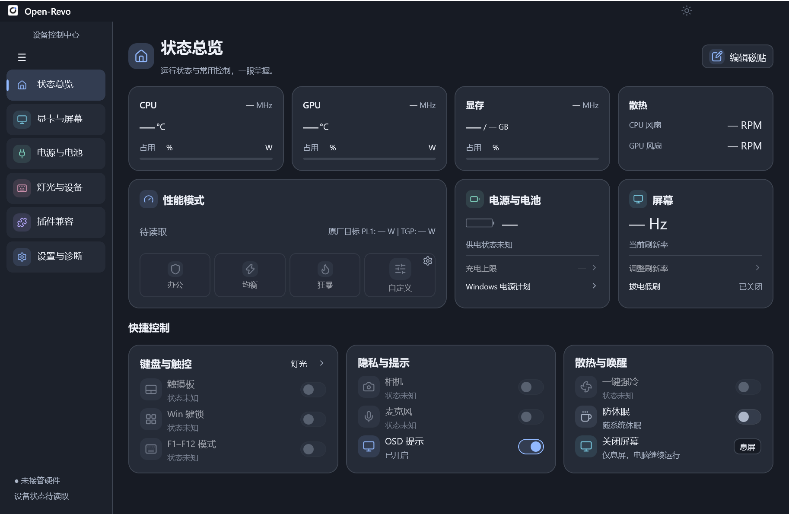

  

<h1 align="center">OpenRevo · WinUI 3</h1>

An open-source Windows control center for compatible MECHREVO and TongFang laptops

  <a href="https://github.com/csucm/open-revo-winUI3/releases/latest"><strong>Download for Windows x64</strong></a> ·
  <a href="https://github.com/csucm/open-revo-winUI3/issues">Report an issue</a> ·
  <a href="README.md">简体中文</a>

OpenRevo WinUI 3 is a community-maintained edition of OpenRevo. Use it to monitor your laptop, switch performance profiles, set a charge limit, and adjust the display and keyboard backlight. The full dashboard brings monitoring and settings together. The tray Mini panel keeps common controls close at hand.

> [!IMPORTANT]
> **The project provides the installer and corresponding source code free of charge.** Download project releases from this repository. OpenRevo WinUI 3 is maintained independently by the community and is not affiliated with or endorsed by MECHREVO, TongFang, or other hardware vendors. [Project releases](https://github.com/csucm/open-revo-winUI3/releases) · [Open-source license](LICENSE)

## Interface preview

<table>
  <tr><th>Dashboard</th><th>Mini panel</th></tr>
  <tr>
    <td></td>
    <td></td>
  </tr>
</table>

These screenshots are from an earlier WinUI build. The controls and live readings vary by device and software version. [More screenshots](docs/previews/native-0.9.8/README.md)

## Features

| Area | What you can do |
| --- | --- |
| Hardware monitoring | See live CPU, GPU, video memory, and fan readings. Customize the tiles on the dashboard. |
| Performance and cooling | Switch between Office, Balanced, and Turbo profiles. On supported devices, use fan boost or tune power limits and fan curves. |
| Power and battery | Check battery and AC status, select a charge limit preset, and manage sleep and power settings. |
| Graphics and display | Switch GPU modes, adjust brightness and refresh rate, and lower the refresh rate on battery where supported. |
| Lighting and quick controls | Adjust the keyboard backlight brightness, color, and effects. Use device shortcuts from the dashboard or Mini panel, with on-screen notifications for profile changes. |
| Tray and appearance | Customize Mini tiles and shortcuts, choose which panel opens from the tray, and switch between light and dark themes. |

The WinUI 3 panel and Rust background process run separately. Closing the panel ends the UI process while the background process keeps the tray icon and enabled policies running. Choose **Exit** in the tray menu to stop the background process.

Hardware features depend on the model, firmware, drivers, and current device state. Even laptops in the same series may offer different graphics, lighting, or cooling controls.

## Install and use

1. Open the [latest GitHub release](https://github.com/csucm/open-revo-winUI3/releases/latest) and download the asset ending in `Setup-x64.exe`. The release page also provides the corresponding source archive and release notes.
2. Before upgrading, exit the previous version from its tray menu. Run the installer, which checks for the .NET 10 x64 Desktop Runtime and Windows App Runtime.
3. Open OpenRevo from the Start menu. Check the hardware control status in **Settings & Diagnostics** before using device controls. Use the tray icon to reopen the panel.

## Open source and redistribution

The project is licensed under **GPL-3.0-or-later**. You may use, study, modify, and redistribute the software under its terms. When redistributing it, follow the applicable requirements for license and copyright notices and corresponding source code. A third-party charge does not imply authorization or endorsement by the project. If a download page charges a fee in the project's name, check the source against this repository. [Full license](LICENSE)

## Usage notes and disclaimer

- **Hardware tuning.** Before changing power limits, fan curves, or GPU modes, save your work, note your original settings, and check that your device and power supply support the change. Use one control tool per hardware setting. If you notice unusual behavior, stop tuning, exit OpenRevo from the tray menu, and check the device state.
- **Compatibility and warranty.** The community cannot verify every combination of model, firmware, and driver. To the extent permitted by applicable law, the software is provided as is, without express or implied warranty. See sections 15 through 17 of the license for the warranty disclaimer and limitation of liability. [Full license](LICENSE)

## Source and feedback

When reporting a hardware issue, include the exact laptop model, BIOS version, and steps to reproduce it. You can export a diagnostic report from **Settings & Diagnostics**. Review the report before uploading it and remove anything you do not want to share publicly. [Report an issue](https://github.com/csucm/open-revo-winUI3/issues) · [Diagnostics](native/DIAGNOSTICS.md)

The application source is under `native/`. [Build instructions](BUILDING.md) · [Documentation](docs/README.md) · [Changelog](CHANGELOG.md)

The WinUI 3 edition is based on [faintonce/open-revo](https://github.com/faintonce/open-revo).
