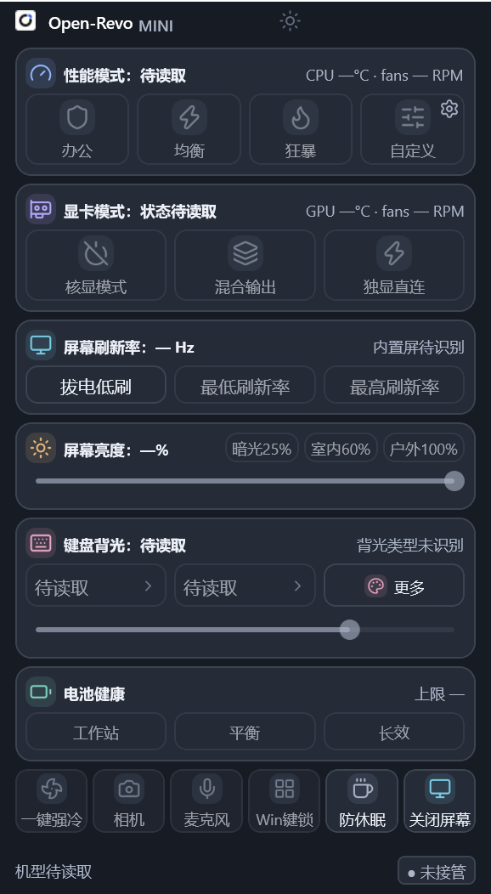

<p align="center">
  
</p>

<h1 align="center">OpenRevo · WinUI 3</h1>

<p align="center">An open-source Windows control center for compatible MECHREVO and TongFang laptops</p>

<p align="center">
  <a href="https://github.com/csucm/open-revo-winUI3/releases/latest"><strong>Download for Windows x64</strong></a> ·
  <a href="#plugin-development-and-contributing">Develop plugins</a> ·
  <a href="https://github.com/csucm/open-revo-winUI3/issues">Report an issue</a> ·
  <a href="README.md">简体中文</a>
</p>

OpenRevo WinUI 3 is a community-maintained edition of OpenRevo. Use it to monitor your laptop, switch performance profiles, set a charge limit, and adjust the display and keyboard backlight. The full dashboard brings monitoring and settings together. The tray Mini panel keeps common controls close at hand.

> [!IMPORTANT]
> **The project provides the installer and corresponding source code free of charge.** Download project releases from this repository. OpenRevo WinUI 3 is maintained independently by the community and is not affiliated with or endorsed by MECHREVO, TongFang, or other hardware vendors. [Project releases](https://github.com/csucm/open-revo-winUI3/releases) · [Open-source license](LICENSE)

## Interface preview

<table>
  <tr><th>Dashboard</th><th>Mini panel</th></tr>
  <tr>
    <td></td>
    <td></td>
  </tr>
</table>

These screenshots are from an earlier WinUI build. The controls and live readings vary by device and software version. [More screenshots](docs/previews/native-0.9.8/README.md)

## Features

### Redesigned WinUI 3 interface and customizable layouts

- **Full dashboard and Mini panel.** The full dashboard brings hardware readings and everyday controls together, with dedicated pages for graphics and display, power and battery, lighting and devices, and settings. Open Mini from the tray to switch profiles, adjust brightness, or use shortcuts while you work.
- **Arrange your dashboard.** Use **Edit tiles** on the dashboard to add, remove, and drag tiles. Put the CPU, GPU, video memory, or fan readings you watch most often first. Save the layout or discard your edits. [Tile editor preview](docs/previews/native-0.9.8/overview-editing.png)
- **Set up Mini separately.** In **Settings & Diagnostics → Mini customization**, choose and reorder the upper tiles and fill up to six quick-access slots at the bottom. Drag controls from the library, swap positions, leave slots empty, or restore the default layout. Save to apply your choices.
- **Choose your theme, motion and on-screen notifications.** Pick light, dark, or the Windows theme. Adjust or turn off interface animations, with respect for the Windows reduced-motion setting. Choose the on-screen display (OSD) style, size, and position and preview it in settings. The tray can open Mini or the full dashboard, or remember the last panel you used. Mini can also hide when you click outside it. [OSD settings preview](docs/previews/native-0.9.8/osd-settings.png)

### Hardware control and monitoring

| Area | What you can do |
| --- | --- |
| Live monitoring | View CPU and GPU temperatures, frequencies, utilization, and power, plus video memory and fan speeds. Available readings vary by device. |
| Performance and cooling | Switch between Office, Balanced, and Turbo. On supported devices, use fan boost, tune CPU and GPU power and fan curves, and save tuning presets. |
| Power and battery | Check battery and AC status, select a 60%, 80%, or 100% charge limit preset on supported devices, and manage sleep and power settings. |
| Graphics and display | Where supported, choose integrated, hybrid, or discrete graphics, adjust the built-in display brightness and refresh rate, and lower the refresh rate on battery. |
| Lighting and shortcuts | Adjust backlight brightness, colors, and effects according to your keyboard type. Use shortcuts such as touchpad, Fn Lock, and Windows key lock where supported. |

The WinUI 3 panel and Rust background process run separately. Closing the panel ends the UI process while the background process keeps the tray icon and enabled policies running. Choose **Exit** in the tray menu to stop the background process.

Hardware features depend on the model, firmware, drivers, and current device state. Even laptops in the same series may offer different graphics, lighting, or cooling controls.

## Plugin development and contributing

**Developers are welcome to help build the OpenRevo native plugin system.** Create a plugin or color theme, or help improve the SDK, examples, documentation, and tests. The C#/.NET 10 SDK supports native pages rendered by the WinUI host, system state and power event subscriptions, per-plugin settings, and static color themes. Plugin code runs in an isolated process. The host checks user authorization and device capabilities before handling actions such as performance profiles, fan boost, and charge limits.

1. Start with the [plugin development guide](native/plugin-dev/README.md) and the [starter template](native/plugin-dev/template/). You can also explore the [system summary example](native/plugin-dev/SystemSummary/) or the [static theme example](native/plugin-dev/NaiwaTheme/).
2. Build the SDK and examples in PowerShell from the repository root.

   ```powershell
   & .\native\plugin-dev\Build-Framework.ps1 -OutputDirectory .\work\native-plugin-framework
   ```

   Choose a folder from the build output's `examples` directory. Place the entire folder, including `plugin.json`, under `plugins` in the OpenRevo installation directory, then select **Refresh** on the plugin page. Review the [capabilities and permissions](native/PLUGIN-API-INVENTORY.md) before adding hardware actions.

3. To propose a new API or improve the framework, describe your use case and the data and permissions it needs in [Issues](https://github.com/csucm/open-revo-winUI3/issues), or submit a pull request. We welcome contributions to native controls, layouts, theme coverage, plugin lifecycle, and developer tools.

The plugin API is under development. Use the host capability query to determine what is available. [Plugin SDK source](native/src/OpenRevo.PluginSdk/) · [Native plugin framework](native/NATIVE-PLUGIN-FRAMEWORK.md)

## Install and use

1. Open the [latest GitHub release](https://github.com/csucm/open-revo-winUI3/releases/latest) and download the asset ending in `Setup-x64.exe`. The release page also provides the corresponding source archive and release notes.
2. Before upgrading, exit the previous version from its tray menu. Run the installer, which checks for the .NET 10 x64 Desktop Runtime and Windows App Runtime.
3. Open OpenRevo from the Start menu. Check the hardware control status in **Settings & Diagnostics** before using device controls. Use the tray icon to reopen the panel.

## Open source and redistribution

The project is licensed under **GPL-3.0-or-later**. You may use, study, modify, and redistribute the software under its terms. When redistributing it, follow the applicable requirements for license and copyright notices and corresponding source code. A third-party charge does not imply authorization or endorsement by the project. If a download page charges a fee in the project's name, check the source against this repository. [Full license](LICENSE)

## Usage notes and disclaimer

- **Hardware tuning.** Before changing power limits, fan curves, or GPU modes, save your work, note your original settings, and check that your device and power supply support the change. Use one control tool per hardware setting. If you notice unusual behavior, stop tuning, exit OpenRevo from the tray menu, and check the device state.
- **Compatibility and warranty.** The community cannot verify every combination of model, firmware, and driver. To the extent permitted by applicable law, the software is provided as is, without express or implied warranty. See sections 15 through 17 of the license for the warranty disclaimer and limitation of liability. [Full license](LICENSE)

## Source and feedback

When reporting a hardware issue, include the exact laptop model, BIOS version, and steps to reproduce it. You can export a diagnostic report from **Settings & Diagnostics**. Review the report before uploading it and remove anything you do not want to share publicly. [Report an issue](https://github.com/csucm/open-revo-winUI3/issues) · [Diagnostics](native/DIAGNOSTICS.md)

The application source is under `native/`. [Build instructions](BUILDING.md) · [Documentation](docs/README.md) · [Changelog](CHANGELOG.md)

The WinUI 3 edition is based on [faintonce/open-revo](https://github.com/faintonce/open-revo).
